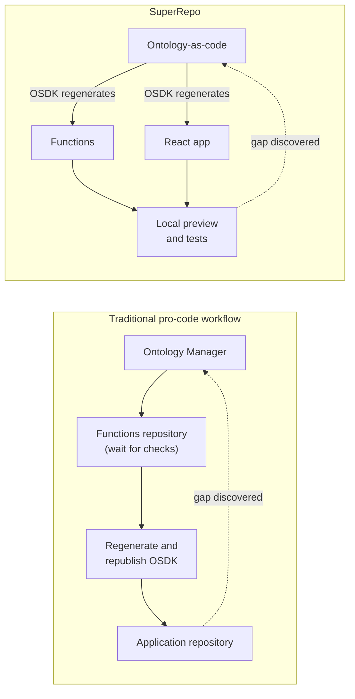
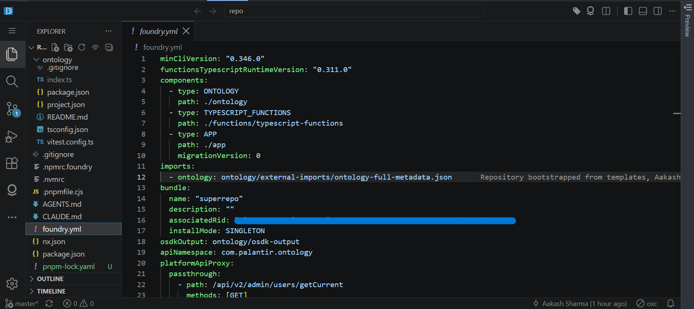
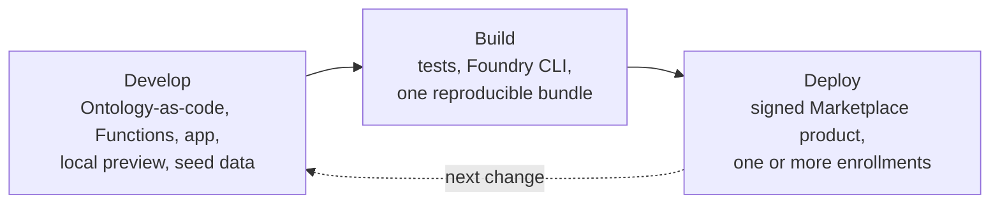
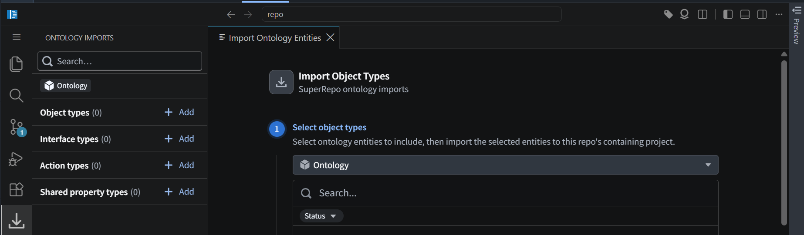
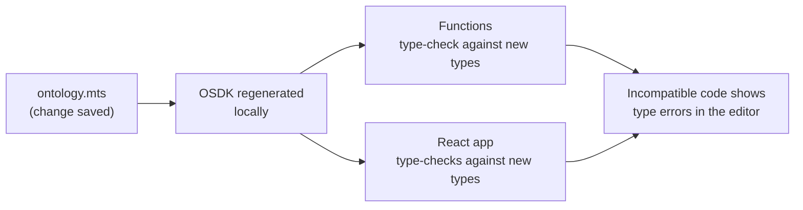
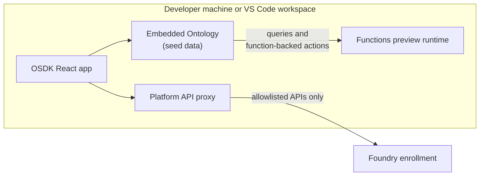
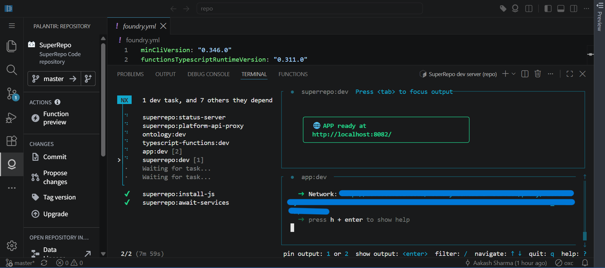
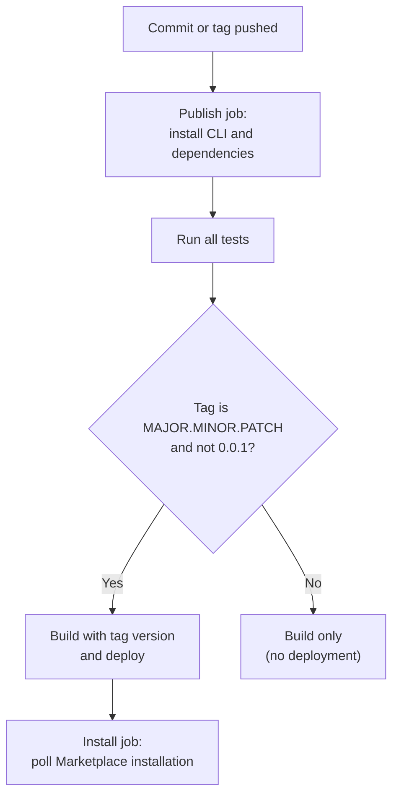
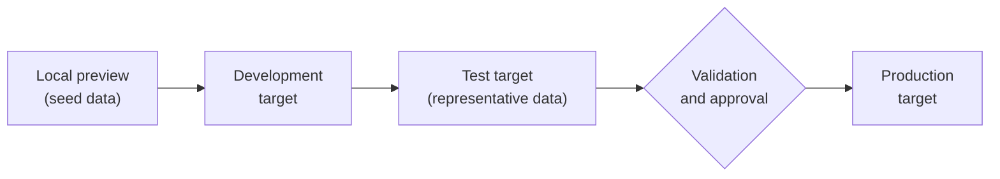

# SuperRepo in Palantir Foundry

*Last updated: October 2026*

> **Scope.** This article explains what SuperRepo is, how it works, and what teams should consider before adopting it. SuperRepo is in **beta**. According to Palantir, it may not be available on every enrollment, and its functionality may change during active development. Capabilities can also vary by enrollment configuration, permissions, and licensing. Code examples come from the default SuperRepo template at the time of writing and may differ between template versions.

## Executive summary

Foundry has long been tightly integrated at **runtime**: pipelines, the Ontology, Functions, Actions, and applications connect beneath the surface. **Building** across those layers has been more fragmented. One feature can mean working in Ontology Manager, a Functions repository, Developer Console, and an application repository, regenerating the Ontology SDK (OSDK) between steps.

SuperRepo brings that development lifecycle into one pro-code repository:

- The Ontology is defined as TypeScript code, next to the Functions and the React application that depend on it.
- A generated OSDK keeps every layer in sync automatically.
- A local preview with an embedded Ontology lets developers run and test the whole application before anything is deployed.
- The repository ships as one reproducible, cryptographically signed Marketplace product, deployed from Foundry's built-in CI or from any external CI/CD system.

According to Palantir, SuperRepo improves application delivery from two angles:

1. **Developer experience:** changes can be tested across the entire application during development, without waiting between stages.
2. **Programmatic DevOps:** code can be hosted anywhere and deployed to multiple environments through the CI/CD system of the team's choice.

Palantir describes SuperRepo as where the Foundry developer experience is heading. It is still early. Python Functions, data pipelines, Automate, and pro-code agents are on the roadmap, not available today. SuperRepo also doesn't remove the need for good Ontology design or for validating against real data. A faster loop makes both more important.

**The central principle: the Ontology and the software built on it should be developed, versioned, tested, and shipped together.**

> **How to read this guide.** Executives can focus on the Executive summary and Sections 1, 2, 11, and 12. Architects and Ontology owners: Sections 3, 4, 9, and 10. Developers: Sections 3 to 5. Release, DevOps, and governance teams: Sections 6 to 8 and the checklist.

## 1. What is SuperRepo?

Palantir defines SuperRepo as Foundry's new approach to building complex full-stack applications anchored around the Ontology inside a pro-code monorepo. SuperRepos expose a growing number of the platform's core components, such as the Ontology, Functions, and React applications, for deeper integration and faster development cycles. According to Palantir, as more platform features gain first-class support, SuperRepo will become the preferred way to work with them in code.

### More than a monorepo

At first glance, SuperRepo looks like a monorepo. The more important change is the development environment around the repository:

| Element | What it provides |
|---|---|
| **Ontology-as-code** | Object types, interfaces, actions, and other entities defined in TypeScript, which become real entities on the enrollment after deployment |
| **Generated OSDK** | SDK bindings regenerated automatically when the Ontology changes, with nothing published to a registry |
| **Embedded Ontology** | A local approximation of the Ontology's behavior, so the application runs on a developer's machine |
| **Seed data** | Local test objects defined in code, never deployed |
| **Foundry CLI** | One tool to create, preview, build, and deploy |
| **Marketplace product** | A reproducible, signed artifact installable on one or more enrollments |

### A new interface, not a separate world

Palantir describes SuperRepo as a new interface for interacting with the platform. Types created in Ontology-as-code are visible in the Foundry UI. Types created in the UI can be imported into a SuperRepo. In Palantir's words, applications are never siloed by how their Ontology types were created.

### What SuperRepo is not

- **Not a replacement for Foundry.** It is a way to develop for the platform.
- **Not low-code.** It targets developers working with Git and CI/CD.
- **Not yet complete.** PySpark transforms, Python Functions, and compute modules are currently out of scope.
- **Not automatically portable.** Ontology dependencies, data integrations, permissions, and environment configuration still need deliberate handling.

## 2. Why SuperRepo matters

### The friction it addresses

The Ontology a team starts with is rarely the one it finishes with. During implementation, teams discover missing relationships, Functions that need another property, or Actions whose behavior must change. Each discovery ripples through several layers. Palantir's tutorial notes that before SuperRepo, a feature spanning the Ontology, Functions, and an application meant jumping between four applications, waiting for CI checks, and republishing the Ontology SDK multiple times.



*Figure 1. In the traditional workflow, each gap means another trip through separate tools. In a SuperRepo, the same loop happens in one repository.*

The friction was never in how these components work together once running. It was in how developers move between them during implementation.

### What changes

| Area | Traditional pro-code workflow | SuperRepo |
|---|---|---|
| Ontology changes | Made in Ontology Manager | Made in TypeScript and versioned like code |
| Functions and frontend | Separate repositories | Components of the same repository |
| OSDK updates | Regenerated and republished as the Ontology changes | Regenerated locally and automatically |
| Cross-layer breakage | Often found after publishing | Surfaced in the editor as type errors |
| Local testing | Largely against the live platform | Embedded Ontology with seed data |
| Packaging | Packaged separately, or assembled into products afterwards | Bundled together into one Marketplace product |
| CI/CD and hosting | Largely Foundry code repositories and Foundry CI | Foundry, or any Git host and CI system |

## 3. Anatomy of a SuperRepo

### The manifest

According to Palantir, a repository is a SuperRepo when it has a `foundry.yml` file at its root, declaring each component's type and path, and the output artifact.



*Figure 2. A newly created SuperRepo. The `foundry.yml` manifest declares three components (`ONTOLOGY`, `TYPESCRIPT_FUNCTIONS`, and `APP`) and the bundle they ship as.*

An abbreviated manifest from the default template:

```yaml
minCliVersion: "0.346.0"
functionsTypescriptRuntimeVersion: "0.311.0"
components:
  - type: ONTOLOGY
    path: ./ontology
  - type: TYPESCRIPT_FUNCTIONS
    path: ./functions/typescript-functions
  - type: APP
    path: ./app
imports:
  - ontology: ontology/external-imports/ontology-full-metadata.json
bundle:
  name: "superrepo"
  installMode: SINGLETON
osdkOutput: ontology/osdk-output
apiNamespace: com.palantir.ontology
platformApiProxy:
  passthrough:
    - path: /api/v2/admin/users/getCurrent
      methods: [GET]
```

| Key | Purpose |
|---|---|
| `components` | Each component's type and path |
| `imports` | Metadata for Ontology entities imported from the enrollment |
| `bundle` | Name and install mode of the output product |
| `osdkOutput` | Where the generated OSDK is written |
| `platformApiProxy` | Platform APIs forwarded to the enrollment during local preview |

### Repository layout

```text
superrepo/
├── foundry.yml             # components and bundle definition
├── ci.yml                  # Foundry CI: test, build, deploy, poll installation
├── AGENTS.md               # instructions for AI coding assistants
├── nx.json, project.json   # build orchestration (replaceable)
├── ontology/
│   ├── src/ontology.mts            # Ontology-as-code
│   ├── src/__tests__/              # Ontology definition tests
│   ├── seed/                       # local-only test data
│   ├── external-imports/           # imported-entity metadata
│   └── osdk-output/                # generated OSDK (never edited by hand)
├── functions/typescript-functions/
│   └── src/functions/              # business logic and its tests
└── app/                            # React application using the OSDK
```

A single SuperRepo can also declare **multiple products**, each with its own components, bundle, and version. That suits related applications that share a team but need separate release cycles.

### The lifecycle at a glance



*Figure 3. The three stages of a SuperRepo's lifecycle.*

## 4. The development lifecycle

### 4.1 Ontology-as-code

According to Palantir, Ontology-as-code TypeScript definitions are compiled and materialized into real entities on the enrollment after deployment. **The code acts as the source of truth**, so all changes should be made through it. From the default template:

```typescript
export const TutorialTask: ObjectTypeDefinition = defineObject({
    apiName: "task",
    displayName: "Task",
    pluralDisplayName: "Tasks",
    titlePropertyApiName: "title",
    primaryKeyPropertyApiName: "id",
    properties: {
        id: { type: "string", displayName: "ID" },
        title: { type: "string" },
        status: { type: "string" },
        assigneeId: { type: "string" },
    },
    editsEnabled: true,
    includeEmptyBackingDatasource: true,
});

export const assignedTasks: LinkType = defineLink({
    apiName: "assignedTasks",
    one: { object: TutorialWorker, metadata: { apiName: "assignedTasks" } },
    toMany: { object: TutorialTask, metadata: { apiName: "assignee" } },
    manyForeignKeyProperty: "assigneeId",
    editsEnabled: true,
});
```

Ontology changes now appear in version control next to the Functions and interface changes that depend on them. Palantir also documents that object types in Ontology-as-code can be backed by declared datasources, including streams, and that media sets can be used through `mediaReference` properties.

### 4.2 Importing the existing Ontology

SuperRepo doesn't require existing entities to be redefined. They can be imported instead.



*Figure 4. The Ontology Imports panel brings existing object types, interface types, action types, and shared property types into a SuperRepo.*

According to Palantir, importing generates both OSDK types and Ontology-as-code types for those entities. The import metadata is written to a lock file that should be committed, because code generation is based on it.

An imported entity is *used* by the SuperRepo but may still be *owned* elsewhere. Changes to it need coordination with that owner.

### 4.3 The generated OSDK

According to Palantir, SuperRepo generates SDK bindings automatically, and the local development servers regenerate them when the Ontology changes. Functions and the application consume the same OSDK.



*Figure 5. One Ontology change reaches every dependent layer through the regenerated OSDK.*

If a property is renamed or removed, or its type changes, dependent code shows type errors while the change is still being written. Two naming rules from the template are worth knowing:

- OSDK names come from each entity's **`apiName`**, not the TypeScript constant. `TutorialTask` is exported as `task`.
- Action API names convert from kebab-case to camelCase. `create-task-action` becomes `createTaskAction`.

### 4.4 Functions, actions, and the application

SuperRepos currently support TypeScript v2 Functions. According to Palantir, **only actions are allowed to change the Ontology's contents**:

- A **Function** contains business logic and can return edits.
- A **function-backed action** applies those edits.
- **Read-only Functions** can be called directly from the application.

The template's Function and its action:

```typescript
function completeTask(
  client: Client,
  taskToComplete: Osdk.Instance<task>,
): OntologyEdit[] {
  if (taskToComplete.status === COMPLETE) {
    throw new UserFacingError(
      `${taskToComplete.title ?? taskToComplete.$primaryKey} is already complete`,
    );
  }
  const batch = createEditBatch<OntologyEdit>(client);
  batch.update(taskToComplete, { status: COMPLETE });
  return batch.getEdits();
}
```

```typescript
export const completeTaskAction: ActionType = defineFunctionBackedAction({
    functionApiName: "completeTask",
    apiName: "complete-task-action",
});
```

In the template, `defineFunctionBackedAction` comes from `@osdk/maker-experimental`, a sign that this API is still evolving. Simple writes don't need a Function: the template defines a create action directly from the object type with `defineCreateObjectAction`.

The React application uses the same OSDK through `@osdk/react` hooks. The template recommends these over hand-written data fetching because they handle caching, de-duplication, and errors:

```typescript
const { data: tasks } = useOsdkObjects(task, { pageSize: 50 });
const completeAction = useOsdkAction(completeTaskAction);
await completeAction.applyAction({ taskToComplete });
```

Putting business rules in Functions rather than the interface means every caller of the action gets the same rule.

### 4.5 Local preview and the embedded Ontology

According to Palantir, preview runs local servers that mock a subset of interactions with a real Foundry instance:



*Figure 6. Local preview. The application runs against the embedded Ontology, which routes queries and function-backed actions to the Functions preview runtime. Only allowlisted platform APIs are forwarded to the enrollment.*



*Figure 7. One command starts the local environment. The Palantir Repository panel also offers Function preview, Commit, Propose changes, and Tag version.*

The template's documentation states that changes to the preview Ontology are never reflected on the Foundry stack. The first start installs every sub-project and generates the OSDK, which can take several minutes. After that, changes reload automatically:

| Component | Reload behavior |
|---|---|
| Application | Hot module reload |
| Ontology server | Regenerates the OSDK when definitions change; wipes and re-seeds when seed data changes |
| Functions runtime | Reloads on change |

### 4.6 Seed data

Local objects come from **seed data** in the Ontology component. From the template:

```typescript
export default createSeed((seed) => {
  seed.create(task, {
    id: "TASK-101",
    title: "Add keyboard shortcuts",
    status: "To do",
    assigneeId: "WORKER-1",
  });
  seed.create(worker, { id: "WORKER-1", name: "Adam Smith" });
});
```

According to Palantir:

- Seed data is local to the preview and **never deployed**.
- Seed files are compiled in sorted filename order.
- Every non-nullable property, including the primary key, must be provided.
- Each run uses a fresh local database, so preview edits are discarded on restart.

Good seed data covers edge cases and failure states, not only the happy path.

### 4.7 Platform APIs and browser security

According to Palantir, some APIs, such as language-model provider proxies, are not implemented by the preview server. They can be forwarded by listing them under `platformApiProxy`. Forwarded requests use the credentials from `foundry login`, and the setting affects only preview.

Deployed applications that load resources from other origins must allow those origins in the product's Content Security Policy:

```yaml
contentSecurityPolicyAdditions:
  img-src:
    - tile.openstreetmap.org
```

Valid directives are `connect-src`, `frame-src`, `img-src`, `media-src`, `script-src`, `style-src`, `font-src`, and `frame-ancestors`. The setting applies only when the product contains an application component.

## 5. Testing and validation

### Testable by design

According to Palantir, the Foundry CLI ships with the embedded Ontology, so teams can write integration tests spanning their whole workflow. The default template includes tests for each layer:

| Layer | What is tested | Approach in the template |
|---|---|---|
| Ontology | Definitions meet expected rules (primary key, title, edit settings) | Compiled to its internal representation and asserted on |
| Functions | Business rules return correct edits | Mock clients and objects from `@osdk/unit-testing` |
| Application | Components render and behave correctly | jsdom with React Testing Library |

```typescript
it("returns an edit completing the requested task", () => {
  const item = createMockOsdkObject(task, {
    id: "TASK-1", title: "Ship tutorial", status: "To do",
  });
  const edits = completeTask(createMockClient(), item);
  expect(edits).toHaveLength(1);
  const [edit] = edits;
  assert(edit.type === "updateObject");
  expect(edit.properties).toEqual({ status: "Complete" });
});
```

**Ontology linting.** Palantir describes this as an established pattern: Ontology owners write linters that check entity definitions against design guidelines before deployment. Rules about title properties, primary-key conventions, or naming patterns then become a repeatable check instead of a manual review.

### What preview does and does not prove

As development speeds up, the difficulty shifts from implementation to validation. Palantir describes the embedded Ontology as an approximation:

| Local preview shows | Local preview does not show |
|---|---|
| Type safety across every layer | Real operational data and volumes |
| Function and action behavior on seed data | Real permissions, markings, and row-level security |
| End-to-end interface behavior | Every platform API (some must be proxied) |
| Repeatable, isolated test data | Real-time subscriptions (the template notes these are not served locally) |
| Fast feedback while coding | Effects on other applications that share the same entities |

Real data exposes rare values, skewed relationships, unexpected nulls, and scale. Teams should plan a validation stage against representative, non-production data before releasing to production. Global Branching supports isolated development across connected resources, but Palantir's SuperRepo documentation doesn't describe how the two work together at the time of writing.

## 6. Build and release

### Builds

According to Palantir, the build step turns the declared components into a single reproducible artifact. Teams can bring their own build system. The template uses Nx, but the CLI reads neither `nx.json` nor `project.json`, and the template's documentation names Turborepo and Lerna as alternatives. Dependencies are installed with `foundry install pnpm`, not a bare `pnpm install`, so registry credentials for Foundry-hosted packages reach the package manager.

Each release has a **semantic version**, which becomes the Marketplace product version. In a multi-product SuperRepo, each product is bundled with its own version and the bundles are assembled into a single store artifact.

### The CI pipeline

When hosted in Foundry, the template's `ci.yml` defines two jobs that run in order:



*Figure 8. The template's CI pipeline. Tests run before every build, and only valid semantic-version tags deploy.*

| Tag | Result |
|---|---|
| `1.2.0` | Tests, build, deployment, and installation polling |
| `v1.2.0`, `1.2.0-rc1`, or any other format | A successful build that **deploys nothing** |
| `0.0.1` | Reserved for the initial commit; never deploys |
| No tag | Tests and build only |

The second row is an easy mistake: a green build that silently skips deployment.

### External CI

Palantir lists hosting, building, and deploying outside the platform as a guiding principle, and explicitly supports GitHub Actions, CircleCI, and other CI systems through the Foundry CLI:

- Set the product version explicitly at build time. The template warns that otherwise the bundle is versioned `1.0.0`, and a second deployment collides with it.
- According to Palantir, `FOUNDRY_TOKEN` must hold a token with Foundry DevOps publishing permissions.
- Store that token in the CI system's secret store, never in the repository.

## 7. Deployment and installation

### Configuration

Before the first deployment, the target is configured once. According to Palantir, this maps inputs such as the target namespace, Project, and website domain. It writes `env.yml`, which should be committed because Foundry CI reads it on tagged deployments. Palantir's example also maps markings:

```yaml
input_mappings:
  organizationInput:
    type: markings
    markings:
      markingIds:
        - <marking-id>
      stableId: null
  websiteSubdomain:
    type: parameter
    parameter:
      value:
        type: stringValue
        stringValue: my-site.example.palantirfoundry.com
```

Palantir notes that static installation parameters make installation automated and zero-click. A different configuration file can be selected at deployment time, for example one per target.

### Deploying and verifying

| Source location | Deployment path |
|---|---|
| Hosted in Foundry | Tag a version (**Tag version** in the editor, or Git). Foundry CI builds and deploys. |
| Hosted elsewhere | Build and deploy with the Foundry CLI from any CI system or terminal |

According to Palantir, a deployed SuperRepo appears in Marketplace as an installation. For OSDK React applications, two more checks in Developer Console are needed: the website domain must be approved, and the latest asset must be deployed to production.

### Installation locking

According to Palantir, SuperRepo installations are **locked** by default, so their object types can't be edited directly in Ontology Manager. A Project can be unlocked if necessary, but edits to an unlocked type are overwritten on the next deployment. The repository stays the source of truth.

### Environment strategy (recommended)

Palantir positions SuperRepo for deployment to multiple environments. One way to structure promotion:



*Figure 9. A recommended promotion path. Each target has its own deployment configuration and its own inputs.*

## 8. Security and governance

| Concern | SuperRepo mechanism | Organizational responsibility |
|---|---|---|
| Artifact integrity | According to Palantir, a self-contained, reproducible, cryptographically signed bundle | Control who may create release tags |
| Quality gate | The template's CI runs tests before building | Keep tests meaningful; maintain Ontology linting |
| Configuration drift | Locked installations; code as source of truth | Define who may unlock, and review every unlock |
| Access requirements | Markings and Projects mapped in `env.yml` | Review mappings for each target |
| CLI installation | According to Palantir, the in-platform flow provisions a more restricted token than a user-generated one | Prefer the in-platform flow; manage token lifetimes |
| CI credentials | Token with Foundry DevOps publishing permissions | Use a secret manager; grant publishing rights narrowly |
| Browser security | Explicit Content Security Policy additions | Approve every external origin |
| Maintenance | According to Palantir, SuperRepos don't receive managed upgrades | Plan dependency updates; update the CLI with `foundry update self` |
| Beta APIs | Some APIs ship as experimental packages | Track changes and test upgrades |

Credentials should never appear in source files, seed data, configuration, documentation, screenshots, or build logs.

**Recommended responsibilities:**

| Responsibility | Typical owner |
|---|---|
| Ontology design, standards, and linting rules | Ontology owner |
| What is owned in code versus imported | Platform architect |
| Functions, application, seed data, and tests | Development team |
| Dependencies and build configuration | Repository owner |
| Deployment configuration and release approval | Release authority |
| Installation, unlocking, and support | Operations |

## 9. Building for people and agents

**Agents that help build the application.** The template includes an `AGENTS.md` file for AI coding assistants. It explains Foundry concepts, which folders are generated, which `@osdk/react` patterns to use, common pitfalls, and the order in which to build a feature: **Ontology → Function → Action → App.** Generated types, preview, and tests give coding agents the same fast feedback as human developers. Their Ontology changes deserve the same review, because once deployed they become real entities.

**Agents that operate the application.** An operational application doesn't have to be built only around a user interface. A person might use the React application while an agent works with the same Ontology, Functions, and permitted Actions. According to Palantir, an agent engine and Agent SDK are in development, so pro-code agents can be defined in the same repository as the domain model they operate on.

| | Coding agent | Operational agent |
|---|---|---|
| Purpose | Builds and modifies the application | Operates the business through the application |
| Works on | Code, Ontology definitions, tests | Objects, Functions, Actions |
| Review point | Code review and CI | The application's Actions and human oversight |

Both depend on the same Ontology, but their permissions and execution environments differ and should be governed separately.

## 10. Enterprise-scale considerations

In large enterprises, shared objects, Functions, and Actions serve many applications built by different teams. Teams need to decide what belongs in each SuperRepo, which entities are owned in code and which are imported, and how changes to shared resources are coordinated. Possible patterns:

| Pattern | Description | Suits |
|---|---|---|
| Application-owned Ontology | Each SuperRepo defines its own entities | Self-contained applications |
| Shared core, imported | One owner maintains a core Ontology; others import it | A domain model shared by many applications |
| Domain SuperRepo | One SuperRepo owns a business domain's Ontology and main applications | Teams organized by domain |
| Multi-product SuperRepo | Related applications in one repository, versioned independently | Related applications owned by one team |

A single repository simplifies one application's development. It doesn't resolve the dependencies between many independently developed applications. Faster changes make **impact visibility** more important: teams should know which applications and agents depend on shared entities before changing them.

**Ontology design matters more.** A company's Ontology says a great deal about what it is trying to build. As more applications and agents depend on it, its design decisions carry more weight. Ontology-as-code makes changes reviewable, testable, and lintable. It doesn't replace thoughtful modeling.

## 11. Practical example (illustrative scenario)

A field-service application has **Work Orders** and **Technicians**. Supervisors assign work through a React interface, and a Function enforces assignment rules. Mid-development, the team realizes it needs an **Asset** object, so technicians can be matched to assets they are certified to service.

| Layer | Change in the SuperRepo | Feedback |
|---|---|---|
| Ontology | Add Asset and a link from Work Order to Asset | OSDK regenerates automatically |
| Seed data | Add sample assets, including one without certification data | Local Ontology re-seeds |
| Function | Check technician certification against the asset | A type error reveals a missing certification property, which is added |
| Tests | Cover certified, uncertified, and missing-data cases | Run locally and in CI |
| Application | Show the asset on the work-order view | Application reloads |
| Release | Tag a new semantic version | CI tests, builds, and deploys |

Without SuperRepo, the missing property might only have surfaced after a publish-and-test cycle across separate tools. Here it appears while the Function is being written, and every layer ships as one versioned release.

SuperRepo doesn't remove the remaining work. The rule must still be validated against real data, other applications using Work Orders must be checked for impact, and ownership of a shared Asset type must be agreed.

## 12. Where SuperRepo stands today

Today, a SuperRepo can bring together Ontology-as-code (including imported entities), TypeScript v2 Functions, and OSDK React applications, and deploy them as one or more Marketplace products, either from Foundry or from an external CI system. Some parts of the platform are not covered yet. Palantir notes that PySpark transforms and compute modules are not currently supported, and that SuperRepo repositories do not receive managed template upgrades, so maintaining the repository remains the team's responsibility.

Looking ahead, Palantir describes several capabilities as in active development, while noting that they are not available yet and may change. These include Python Functions, an agent engine and Agent SDK for pro-code agents, support for calling external APIs from Functions, pro-code Automate, and data pipelines. If these arrive, the boundaries between Foundry's development tools could become much less visible during development, even though the underlying platform capabilities remain distinct.

In our view, SuperRepo is currently best suited to teams building new full-stack applications around the Ontology, especially teams already comfortable with Git, code review, and CI/CD. Applications that rely heavily on shared Ontology entities can still work through imports, but ownership needs to be agreed upfront. Given its beta status, starting with a lower-risk pilot is a sensible way to adopt it.

## Best practices at a glance

- **Treat the Ontology as code.** Review, test, and version it with the code that depends on it.
- **Import before redefining,** and commit the import lock file.
- **Make ownership explicit** for every entity a SuperRepo owns or imports.
- **Follow the dependency order:** Ontology → Function → Action → App.
- **Put business rules in Functions,** not the interface.
- **Design seed data deliberately,** including edge cases.
- **Automate Ontology standards** as checks that run before deployment.
- **Validate against representative data.** Preview is not production.
- **Use strict `MAJOR.MINOR.PATCH` tags.**
- **Keep the repository the source of truth.** Avoid editing installed resources.
- **Protect publishing credentials,** and never commit tokens.
- **Review agent-generated changes** like human ones.

## Implementation checklist

**Readiness and design**
- [ ] SuperRepo is available on the enrollment, and a low-risk pilot application is chosen.
- [ ] Owners are named for the repository, Ontology definitions, and releases.
- [ ] Owned and imported entities are documented, with agreed change coordination.
- [ ] Ontology naming and design standards are documented.

**Development and validation**
- [ ] `foundry.yml` declares every component and the bundle; the import lock file is committed.
- [ ] Seed data covers representative and edge-case scenarios.
- [ ] Ontology, Function, and application tests run in CI.
- [ ] Validation against representative, non-production data is planned.
- [ ] Impact on applications that share entities is reviewed.

**Release and operations**
- [ ] The tagging procedure is documented; `env.yml` is committed and reviewed for each target.
- [ ] Publishing credentials are stored securely and scoped narrowly.
- [ ] Installations are verified in Marketplace; app domains are approved and assets deployed.
- [ ] A policy for unlocking installations is defined.
- [ ] Dependency and CLI updates are scheduled; support ownership is assigned.

## Conclusion

Foundry already integrates its capabilities at runtime. SuperRepo brings that integration into how applications are built. Ontology-as-code, Functions, a continuously generated OSDK, React applications, local preview, automated tests, and signed Marketplace products come together in one development lifecycle.

The result isn't just more code in one repository. The operational model and the software built around it now evolve together, are tested together, and ship together. SuperRepo doesn't remove the need for good Ontology design, careful validation, or architectural thinking across teams. As development speeds up, those disciplines matter more.

SuperRepo is still in beta, and much of its intended scope is on Palantir's roadmap. Its direction is clear: less time moving between tools, and more time on the operational model being built.
