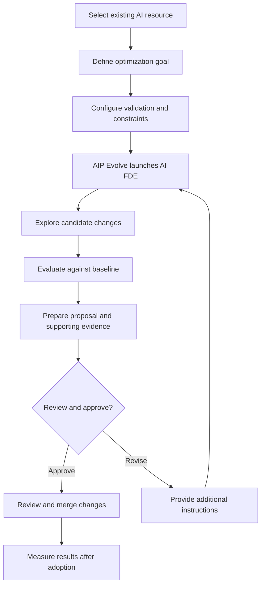
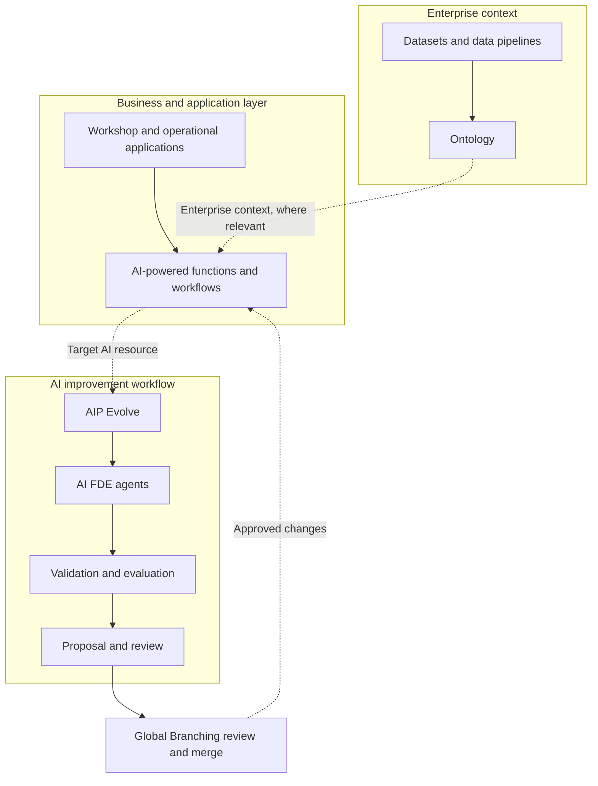

# AIP Evolve in Palantir Foundry
*Advancing Enterprise AI Through Agent-Driven Optimization*

## 1. What Is AIP Evolve?

Enterprise AI development does not end when an application goes live. Over time, organizations need to reduce operating costs, improve response times, maintain output quality, and adapt to changing models and business requirements.

**AIP Evolve is a Palantir Foundry capability that coordinates fleets of AI Forward Deployed Engineer (AI FDE) agents to improve existing AI systems.** Users define the target, optimization goal, validation strategy, and operational constraints. The agents explore potential improvements, evaluate candidate changes, and prepare a proposal for review before changes are merged.

Common optimization goals include:
- Reducing model inference costs.
- Improving response latency.
- Increasing evaluation scores.
- Migrating to alternative models.
- Pursuing custom optimization objectives.

AIP Evolve is part of Palantir's broader Artificial Intelligence Platform (AIP). It focuses on improving existing AI implementations rather than replacing the tools used to build applications, manage enterprise data, or deliver operational workflows.

### The evolution of enterprise AI

| Stage | Focus | Key activity |
|---|---|---|
| Build | Develop AI capabilities | Create prompts, functions, models, and workflows |
| Deploy | Operationalize AI | Integrate AI into business processes and applications |
| Evolve | Improve existing AI | Explore changes, validate outcomes, and review proposals |

*This is an explanatory framework, not an official Palantir maturity model.*

## 2. The Problem: Why Is AIP Evolve Needed?

Once an AI workflow is operational, improving it can require repeated experiments, engineering effort, and careful validation. A cheaper model might produce less reliable results; a faster prompt might introduce regressions; and a change that works for one scenario may fail on another.

| Pain point | Business impact | Engineering challenge |
|---|---|---|
| High inference costs | Higher operating expenditure | Find lower-cost alternatives without unacceptable quality loss |
| High latency | Slower business processes and poor user experience | Compare model and workflow alternatives |
| Inconsistent outputs | Reduced trust and more manual correction | Define meaningful evaluation criteria |
| Manual experimentation | Longer optimization cycles | Run and compare experiments efficiently |
| Regression risk | Potential operational disruption | Validate candidate changes against a baseline |
| Changing models and requirements | Repeated maintenance effort | Reassess existing implementations over time |

AIP Evolve addresses these challenges through a structured, agent-driven optimization process. It does not automatically guarantee lower costs or better quality; results depend on the target system, evaluation strategy, and available alternatives.

**Central question:** Can AI-assisted engineering reduce the effort required to improve an existing AI system while preserving measurable quality and appropriate change controls?

## 3. How AIP Evolve Works

AIP Evolve turns an optimization objective into an iterative engineering workflow. Users specify what should improve, how success will be measured, and what changes agents are permitted to make.

### Optimization lifecycle

### Key steps

1. **Select the target:** Identify the AI function or workflow to improve.
2. **Define the goal:** Choose an objective such as cost reduction, lower latency, model migration, or evaluation-score improvement.
3. **Set validation and constraints:** Select representative test cases or evaluation suites, configure scoring criteria and acceptable output divergence, and limit permitted changes and iterations.
4. **Explore alternatives:** AI FDE coordinates engineering activities to inspect the target, explore candidate changes, and evaluate their results.
5. **Compare results:** Review the baseline and candidate outputs, evaluation results, supporting evidence, and confidence assessments.
6. **Review and merge:** Inspect the proposed changes through Global Branching, where applicable, before merging.
7. **Measure operational impact:** Confirm that the adopted change delivers the intended business outcome.

The key distinction is that AIP Evolve does more than suggest a change. It coordinates iterative exploration and validation against a defined objective, then presents a proposal for review.

However, passing an evaluation is not proof of production correctness. Test coverage, representative data, evaluation quality, and appropriate human review remain essential.

## 4. Integration With the Foundry Ecosystem

AIP Evolve operates within the wider Foundry environment. The following diagram groups capabilities by responsibility rather than representing an exact deployment topology.

### Conceptual architecture

### Responsibilities of the main components

| Component | Primary responsibility | Relationship to AIP Evolve |
|---|---|---|
| AIP Evolve | Coordinate the optimization process | Defines the goal and manages the evolution workflow |
| AI FDE | Execute engineering tasks using an AI agent | Explores and evaluates candidate changes |
| AIP Evals | Test AI functions using test cases and evaluation criteria | Can provide a structured way to assess candidate quality |
| Ontology | Model enterprise objects, relationships, logic, and actions | Required installation context for the AIP Evolve Marketplace product |
| Global Branching | Manage and review proposed changes | Supports review before changes are merged |
| Workshop | Build operational applications and interfaces | May host the business workflow using the AI capability being optimized |
| Datasets and pipelines | Provide and transform enterprise data | May supply the data and context used by the target AI system or its validation |

AIP Evolve requires AIP to be enabled, access to AI FDE, installation of the AIP Evolve Marketplace product in an Ontology, and access to the target resource and any validation data or evaluation suites used.

Workshop is part of the broader Foundry ecosystem, but it is not a universal prerequisite for using AIP Evolve.

## 5. How AIP Evolve Differs From Other Foundry Capabilities

The distinction is primarily about responsibility within the AI lifecycle.

| Capability | Primary purpose | How it complements AIP Evolve |
|---|---|---|
| AIP Logic | Build AI-powered functions and workflows | Provides AI components that may be optimized |
| AIP Evals | Evaluate AI functions against test cases and metrics | Helps assess quality and compare candidate results |
| AI FDE | Carry out engineering operations through an AI agent | Performs the agent-driven work coordinated by Evolve |
| Workshop | Build user-facing operational applications | Provides interfaces for business users |
| Ontology | Represent enterprise objects, relationships, and actions | Supplies the broader enterprise context |
| Global Branching | Review and manage proposed changes | Supports controlled change review and merging |
| **AIP Evolve** | **Coordinate iterative optimization of existing AI systems** | **Connects goals, agent-driven exploration, validation, and proposal review** |

AIP Evolve does not replace the other capabilities. Its purpose is to bring a structured optimization process to an existing AI implementation, using relevant Foundry tools and resources where applicable.

## 6. Business Value and Practical Applications

### Illustrative example: AI-powered inventory allocation

Consider a company using an AI workflow to interpret customer orders and recommend how inventory should be allocated. The workflow is already operational, but its compute cost is higher than desired.

**Step 1 — Establish the baseline**

Record the current model, cost per call, response latency, evaluation results, and performance on representative test cases.

**Step 2 — Define the optimization**

Set a cost-reduction goal, choose representative validation cases, define acceptable output divergence, and restrict the types of changes agents may propose.

**Step 3 — Explore and validate**

AIP Evolve coordinates AI FDE agents to investigate the workflow, explore alternatives such as model or prompt changes, and compare candidate results against the baseline.

**Step 4 — Review the proposal**

Inspect the recommended changes, cost measurements, output comparisons, evaluation results, and limitations. Review the proposed changes before merging.

**Step 5 — Measure the outcome**

After adoption, measure performance under comparable workloads and verify that the optimization has not introduced unacceptable regressions.

### Suggested business KPIs

| Intended outcome | KPI |
|---|---|
| Lower AI expenditure | Cost per successful task; monthly inference cost |
| Better responsiveness | Median and p95 latency |
| Improved output quality | Evaluation pass rate; task-specific quality score |
| Fewer regressions | Critical test failures; post-release incident rate |
| Higher engineering productivity | Engineer-hours per optimization cycle |
| Faster delivery | Time from optimization request to approved change |

A successful optimization balances cost, speed, and quality. Reducing compute cost alone does not prove that the business outcome has improved.

Where actual results are available, present a before-and-after comparison using equivalent workloads and test conditions. Otherwise, label the example as illustrative rather than presenting hypothetical savings as measured results.

## 7. Conclusion and Strategic Implications

AIP Evolve extends Foundry's AI engineering capabilities by coordinating AI FDE agents to explore and validate improvements to existing AI systems. It gives teams a structured way to pursue objectives such as lower cost, reduced latency, improved evaluation scores, and model migration.

Its value can be considered from three perspectives:

- **Business leaders:** A way to pursue measurable improvements in AI operating costs, responsiveness, and quality.
- **Architects and engineers:** A structured process for agent-driven experimentation, evaluation, and proposed changes.
- **Governance teams:** An opportunity to combine explicit constraints, evaluation evidence, and review practices with human oversight.

The results still depend on sound evaluation design, representative test cases, appropriate permissions, and disciplined review. AIP Evolve should therefore be viewed as an optimization capability—not a guarantee of autonomous, risk-free improvement.

**In short:** Foundry provides the environment to build and operate enterprise AI solutions; AIP Evolve helps teams systematically improve those solutions over time.

### References

1. [Palantir — AIP Evolve overview](https://www.palantir.com/docs/foundry/aip-evolve/overview)
2. [Palantir — AI FDE overview](https://www.palantir.com/docs/foundry/ai-fde/overview)
3. [Palantir — AIP Evals overview](https://www.palantir.com/docs/foundry/aip-evals/overview)

---

 and measurable outcomes. For technical practitioners, emphasize orchestration, evaluation design, constraints, baseline comparisons, and change management.
